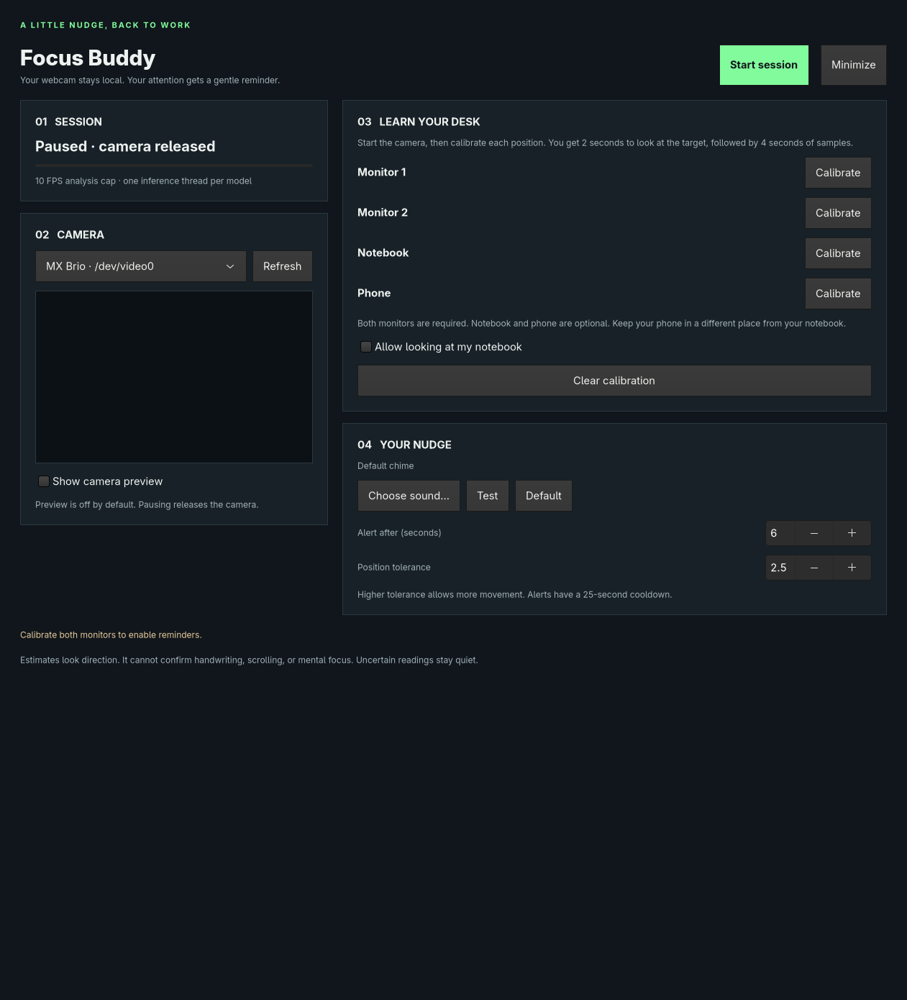

# Focus Buddy



A small Rust desktop app for Linux that plays your chosen sound when your
webcam estimates that you have looked away from your working positions for
several seconds. Everything runs locally. Camera frames stay in memory and
are discarded; there is no recording, cloud service, browser, or account.

## Run

The project lives in `~/DevStuff/projects/focus-buddy`.

```sh
./bin/fetch-models
./bin/build
./target/release/focus-buddy
```

Requires Rust/Cargo, GTK 4.10+, FFmpeg/ffplay, and the ONNX Runtime CPU shared
library. On this Arch/Omarchy machine these system libraries were already
installed. Rust bindings are pinned in Cargo.lock. `./bin/install` builds an
Arch package and installs its launcher entry through makepkg/pacman; this can
request sudo. Building and running directly does not install anything system-wide.

## Set up your desk

1. Select your webcam and press **Start session**. Capture uses a 640×480
   V4L2 stream; if the camera exposes several nodes, try its capture node.
2. Calibrate **Monitor 1**, then **Monitor 2**. Each capture gives you two
   seconds to look at the target, then collects at least 20 valid readings
   over four seconds. Keep a natural working position and look around a
   small area of the target. Reminders stay disabled until both are calibrated.
3. In **Settings**, turn **Notebook mode** on when you want to use notes, then
   calibrate **Notebook**. Turn the mode off to skip it; calibration is retained
   when switching modes. Calibrate
   **Phone** where you normally hold it; place it away from the notebook.
   Calibration rejects overlapping phone and working positions.
4. Under **Find sound effects**, open Myinstants or add your own website links.
   Download a sound in your browser, then choose a local WAV, MP3, OGG or
   other FFmpeg-supported sound and press
   **Test**. The default is a short generated chime. Playback does not overlap.
5. Adjust the alert delay (default six seconds) and position tolerance.
   Higher tolerance allows more movement. After the delay, your sound loops
   continuously until you return to either monitor or an enabled, calibrated
   notebook position. Each new distraction starts a fresh delay; there is no cooldown.
6. Press **Hide to tray** or close the window to keep monitoring without a
   tiled window. Click the tray icon or open Focus Buddy from Apps to return.
   Hover over the tray icon to see the current status and notebook mode.
   Right-click for **Open**, **Start/Pause**, **Notebook mode**, or **Quit**.
   **Pause** releases the webcam; **Quit** stops monitoring and exits. There
   is no autostart. If the tray host goes away, the app reopens its window.

Recalibrate after moving your camera, notebook, monitors, or seating position.
Switching camera devices clears calibration. The camera identity is checked
again at session start. Saved settings are written atomically to
`~/.local/share/focus-buddy/state.json` (or your XDG data directory).

| Shortcut | Action |
| --- | --- |
| Space | Pause a running session when focus is not in a control |
| Ctrl+Q | Quit |

## What this version can tell

It estimates **look direction**, using relative facial geometry and approximate
eye position. It does **not** recognize handwriting, identify phone objects,
confirm scrolling, or measure mental focus. The phone setting is a calibrated
look position, not an object detector. You can still browse distractions on a
monitor without triggering an alert.

Missing faces, multiple faces, closed/poorly visible eyes, and ambiguous
positions reset the initial alert timer. Once an alert is sounding, uncertain
readings keep it looping until a working position is recognized. Stale camera
frames, camera errors, Pause, calibration, and changes to detection settings
stop the loop. Turning fully away before the first alert can still go unalerted. Glasses, reflections,
dim light, and overlapping phone/notebook positions can limit accuracy.
Live desk accuracy has not yet been measured.

## Resource use

Camera output and inference are capped at 10 FPS. A single latest-frame slot
replaces old frames instead of queuing them. Each model has one inference
thread, with idle thread spinning disabled. Preview is off by default. Pausing
kills and reaps the camera process. GTK uses the desktop's graphics stack;
GPU inference is not enabled without measurements showing a benefit.

Rust is used for memory safety, predictable ownership, and concurrency. It is
not assumed to use less memory than C or C++; model sessions, frame buffers,
GTK, and FFmpeg account for much of the footprint. The program uses the system
ONNX Runtime and FFmpeg rather than reimplementing inference or camera codecs.

## Check and develop

```sh
./bin/test
./target/release/focus-buddy --check
./target/release/focus-buddy --bench path/to/a/face.jpg
./target/release/focus-buddy --smoke
./target/release/focus-buddy --camera-check /dev/video0
```

`--check` verifies model hashes and performs blank-frame inference without a
camera or display. `--bench` reports median/p95 inference time for a still
image. Neither measures webcam gaze accuracy. `--smoke` opens the native
window briefly and saves `target/ui-smoke.png`; it never opens the webcam. `--camera-check` captures for five seconds, reports frame and eye
reading counts, then releases the camera without recording.

`FOCUS_BUDDY_MODELS` overrides the model directory. `ORT_DYLIB_PATH` overrides
`/usr/lib/libonnxruntime.so`. After installing the Arch package, models also
exist at `/usr/share/focus-buddy/models`.

The modes and reminder controls live in **Settings**. Notebook mode can be
turned on before calibration, but its position is only allowed after you
calibrate it. Turning it off immediately removes that position from the
working set without deleting its saved calibration. The camera preview is
hidden by default and stops rendering when the window is hidden.

Tray support uses the freedesktop StatusNotifierItem protocol through `ksni`;
Omarchy supports it directly, so no shell plugin or configuration change is
needed. Some Omarchy setups put new tray icons in the expandable tray drawer.

The optional desktop integration check uses the installed Python PyGObject
bindings and Hyprland to exercise the real D-Bus menu and window lifecycle,
with an isolated tray host and isolated saved settings:

```sh
cargo build --locked
dbus-run-session -- /usr/bin/python tests/desktop.py
```

Source: `tray.rs` owns the tray protocol and menu; `ui.rs` owns the GTK controls; `camera.rs` owns the bounded capture
worker; `vision.rs` runs the models; `focus.rs` handles calibration and alert
timing; `settings.rs` saves state; `audio.rs` manages one audio player.

Website bookmarks open in your default browser only when clicked. Myinstants
is an external website, not bundled audio. Saved website names and URLs can
be added or removed in the sound section. The app makes no background
requests to these websites. Its sound picker starts in Downloads when no
sound has been selected.
