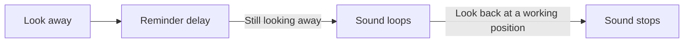

<div align="center">
  
  <h1>Focus Buddy</h1>
  <p>A little nudge. Back to work.</p>
  <p>A native Rust app for Linux that turns a look away into a sound reminder.<br>
  Webcam analysis stays on your computer. You choose the sound.</p>
  <p><a href="https://github.com/Suman196pokhrel/focus-buddy/actions/workflows/ci.yml"></a></p>
  <p><a href="#install">Install</a> · <a href="#first-session">First session</a> · <a href="docs/guide.md">User guide</a> · <a href="CONTRIBUTING.md">Contribute</a></p>
</div>

<p align="center">
  
</p>

## At a glance

| Feature | What it does |
| :--- | :--- |
| **Local by design** | Frames stay in memory. No recordings, uploads, accounts, or telemetry. |
| **Your sound** | Choose a local audio file or the included chime. Reminders loop until you look back. |
| **Your desk** | Save two screen positions, with optional notebook and phone positions. |
| **Tray controls** | Close the window to keep your session running. Reopen, pause, or quit from the tray. |

**Platform:** tested on Arch Linux / Omarchy, x86-64. Windows and macOS are not
supported yet. Other Linux systems require a [source build](docs/guide.md#other-linux-distributions).

## Install

You need a webcam, two screens, audio output, internet access, and administrator
access to install packages. On Arch Linux / Omarchy:

```sh
sudo pacman -Syu --needed git
git clone https://github.com/Suman196pokhrel/focus-buddy.git
cd focus-buddy
./install.sh
```

Run the installer as your regular user. It installs missing dependencies,
downloads verified models, builds the app, and adds **Focus Buddy** to your
launcher. The first build takes several minutes; no prebuilt release is available yet.

Prefer a ZIP? [Download the source](https://github.com/Suman196pokhrel/focus-buddy/archive/refs/heads/main.zip),
extract it, open a terminal in that folder, and run `sh install.sh` on an
up-to-date Arch system. To check dependencies without installing anything,
run `./install.sh --check`.

## First session

1. **Start setup.** Open Focus Buddy from your launcher and choose your webcam.
2. **Set your screens.** Look at Screen 1 and choose **Set position**. Keep
   looking there for about six seconds, then repeat for Screen 2.
3. **Make it yours.** Choose and preview a sound. Enable **Notebook mode** and
   set its position if you take notes; a phone position is optional.
4. **Get to work.** Reminders begin once both screens are set. Adjust the
   reminder delay in Settings; the default is six seconds.

## How reminders work



A working position is either saved screen, or your saved notebook when
Notebook mode is on. Returning before the delay ends cancels that reminder.
Unclear readings do not start a reminder; an active sound continues until a
working position is recognized. Pausing or a camera error stops playback.

Detection estimates look direction. It cannot identify phone objects,
recognize handwriting or scrolling, or tell whether you are mentally focused.
Lighting and camera placement affect results. [Detection limits →](docs/guide.md#detection-limits)

## Everyday controls

| Action | Result |
| :--- | :--- |
| **Pause session** | Stops the sound and releases the webcam. |
| **Close / Hide to tray** | Keeps the current session running without an open window. |
| **Open from tray or launcher** | Returns to the same window. |
| **Notebook mode off** | Stops allowing the notebook position; keeps it saved for next time. |
| **Quit / Ctrl+Q** | Stops monitoring and exits. |

The camera starts only when you start a session. Preview is off by default;
there is no autostart. After moving your camera or desk, update your saved positions.

## Further reading

[User guide](docs/guide.md) · [Update or uninstall](docs/guide.md#update-or-uninstall) ·
[Troubleshooting](docs/guide.md#troubleshooting) · [Contributing](CONTRIBUTING.md) ·
[Security](SECURITY.md)

[MIT license](LICENSE). Dependencies and models retain their own licenses;
see [model sources and notices](models/README.md).
