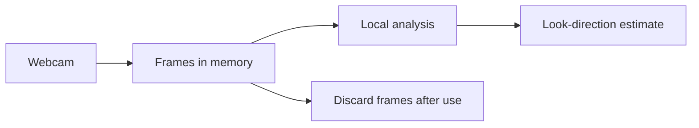

# User guide

[← Back to Focus Buddy](../README.md)

## Installation details

The [quick install](../README.md#install) targets Arch Linux / Omarchy on x86-64.
Run it as your regular user. Only package installation requests administrator
access; the build runs without root privileges.

The installer adds missing dependencies, fetches the pinned models and Rust
dependencies, builds an Arch package, and installs it with pacman. It then
checks inference without opening your webcam. The first build takes several
minutes; subsequent builds reuse downloaded dependencies.

It chooses the CPU ONNX Runtime package only when a compatible provider is not
already installed. It does not add startup services or change desktop settings.
Run `./install.sh --check` for a dependency check that changes nothing.

## Set up your desk

1. Choose your webcam and click **Start setup**. **Show camera preview** is
   optional; the preview is off by default.
2. Look naturally at Screen 1 and choose **Set position**. Keep looking there
   for about six seconds. Repeat for Screen 2. Both must be saved before
   reminders begin.
3. Turn on **Notebook mode** if you take handwritten notes and set its position.
   Turn it off for sessions without notes; its saved position is retained.
   You can also set a **Phone** position where you normally hold your phone.
   Keep the notebook and phone positions apart.
4. Use **Choose sound…** to select a local sound, then **Preview sound**.
   WAV, MP3, and OGG are supported through FFmpeg. **Use chime** restores the
   included sound. Website links open in your browser: download a sound there,
   then choose the file in Focus Buddy. External sites have their own privacy
   policies and audio licenses.
5. Set **Remind me after** in Settings (six seconds by default). Your sound
   loops after that delay until a working position is recognized. Each new
   distraction starts a fresh delay. Under **Fine-tune detection**, increase
   movement allowance only if normal head movement triggers reminders.

Moving your camera, screens, notebook, or chair may require **Update position**.
Switching cameras clears saved positions. **Reset saved positions…** asks for
confirmation and keeps your sound and preferences.

## Window and tray

Closing the window or choosing **Hide to tray** keeps the current session
running. Click the tray icon or open Focus Buddy from the launcher to return.
Hover over the icon for status; right-click to open, start/pause, toggle
notebook mode, or quit. Omarchy may put the icon in its expandable tray drawer.
If the tray host disappears, the window reopens.

**Pause session** releases the webcam and stops the sound. **Start session**
uses your saved setup. **Quit** or **Ctrl+Q** exits completely; **Space** pauses
a running session when keyboard focus is outside a control. There is no autostart.

## Detection limits

Focus Buddy estimates look direction from facial landmarks and approximate
eye position. It does not identify phone objects, recognize handwriting,
confirm scrolling, or measure mental focus. Browsing distractions on a
working screen will still look like work to this app.

Poor light, glasses, reflections, closed eyes, multiple faces, or overlapping
working positions can cause uncertain readings. Uncertain readings do not
start a reminder; once a reminder is sounding, it keeps looping until a
working position is recognized. Turning fully away before the first alert
may go unalerted. Stale frames, camera errors, pausing, position setup, and
changes to detection settings stop the sound. Live desk accuracy has not
been measured across users.

Analysis is capped at 10 frames per second, with one inference thread per
model and a single latest-frame slot. Hidden previews are not rendered.
Rust helps with memory safety; GTK, FFmpeg, and ONNX Runtime still determine
much of the memory footprint. No resource benchmark is implied.

## Privacy



Camera frames stay on your computer and are not recorded or uploaded. Setup
downloads models and dependencies; website bookmarks open externally only
when clicked. There are no accounts or telemetry.

Preferences, calibration values, camera identity, local sound paths, and
website links are saved at `~/.local/share/focus-buddy/state.json`, or
`$XDG_DATA_HOME/focus-buddy/state.json` if that variable is set. These settings
are personal data: do not include them in public bug reports.
See [SECURITY.md](../SECURITY.md) for file permissions, model verification,
dependency advisories, and reporting guidance.

## Update or uninstall

For a Git checkout, run these commands in the project folder:

```sh
git pull --ff-only
./install.sh
```

For a ZIP download, extract the newer version and run its installer. Quit and
reopen an already-running copy after upgrading. Your saved setup is retained.

To uninstall the app and models:

```sh
sudo pacman -R focus-buddy
```

Personal settings remain in your user data directory. Remove the
`focus-buddy` folder there manually only if you also want to delete your setup.

## Other Linux distributions

The automatic installer targets Arch and Omarchy. Other Linux desktops need
**GTK 4.10+** and its development files, **Rust/Cargo 1.89+**, a C build toolchain,
`pkg-config`, `curl`, `sha256sum`, **FFmpeg with ffplay**, and the CPU shared
library from [ONNX Runtime 1.22+](https://onnxruntime.ai/docs/install/).
Use distribution packages where available. Windows and macOS are not supported.

With prerequisites installed, run from the project folder:

```sh
./bin/fetch-models
./bin/build
./target/release/focus-buddy --check
./target/release/focus-buddy
```

The default runtime library path is `/usr/lib/libonnxruntime.so`. If your
distribution uses another location, set `ORT_DYLIB_PATH` to its absolute `.so`
path before running the app. `FOCUS_BUDDY_MODELS` overrides the model directory.
Installed Arch packages use models at `/usr/share/focus-buddy/models`.

Tray support requires a StatusNotifierItem host. The full desktop flow has
only been tested on Omarchy/Hyprland; other desktops may need extra tray support.
Build checks and development commands are in [CONTRIBUTING.md](../CONTRIBUTING.md).

## Troubleshooting

| Problem | Try this |
| :--- | :--- |
| **No camera or picture** | Close other camera apps, reconnect your webcam, and click **Refresh**. Some cameras expose several entries; try another. Capture requires a 640×480 V4L2 stream. Check your distribution's permissions rather than making devices world-writable. |
| **Sound keeps playing** | Look back at a saved working position or choose **Pause session**. Update positions after moving your desk setup. |
| **Sound will not play** | Preview the included chime and check your audio output. Keep custom files in their saved locations. Network playlists are blocked. |
| **Model or runtime error** | Run `focus-buddy --check`. On Arch, rerun the installer. For source builds, run `./bin/fetch-models` and check `ORT_DYLIB_PATH`. |
| **Invalid saved settings** | The original is preserved and saving is blocked. Quit, rename `state.json` to `state.json.backup`, then reopen and set up again. Keep the backup private. |
